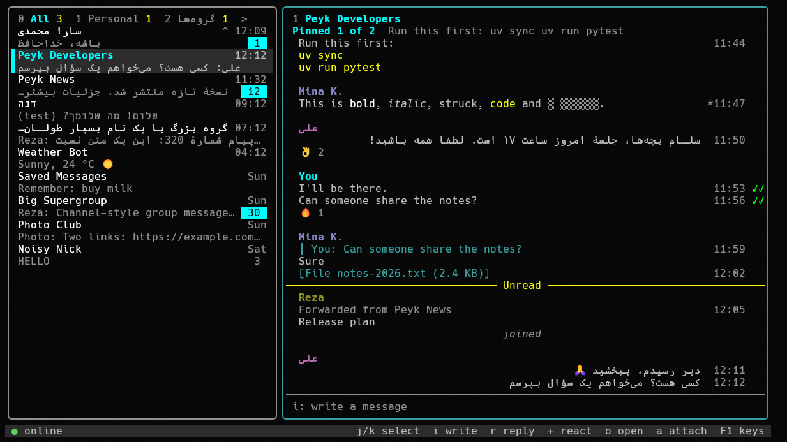
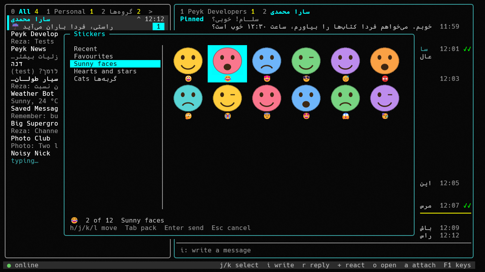
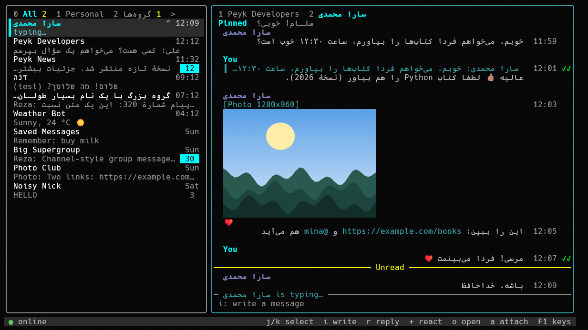

# Peyk

A Telegram client for the Windows terminal, used from the keyboard like vim. No WSL, no compiler.

Chats and folders, tabs, replies, edits, formatting, reactions, search, files and pictures (shown in
the terminal), stickers and GIFs, voice messages, forwarding, pinned messages, notifications, and
Persian, Arabic and Hebrew text. One account; no secret chats or calls.



*The made-up chats of `peyk --demo`, in Windows Terminal.*

## Install

You need Windows 10 or 11 and [Windows Terminal](https://aka.ms/terminal) (1.22 or later shows
pictures sharply). Python is not needed: uv brings its own.

1. Install [uv](https://docs.astral.sh/uv/), in PowerShell:

   ```powershell
   powershell -ExecutionPolicy ByPass -c "irm https://astral.sh/uv/install.ps1 | iex"
   ```

2. Install Peyk, then open a new terminal:

   ```powershell
   uv tool install git+https://github.com/FarahaniMehrshad/peyk
   ```

   If `peyk` is then not found, run `uv tool update-shell` and open a new terminal again.

3. Get API keys. Telegram wants every app to have its own: sign in at <https://my.telegram.org>,
   open "API development tools", and create an app (any name and short name will do). Keep the
   page open: you need its `api_id` and `api_hash`.

4. Run `peyk`. It asks for the two keys (and a proxy, if you need one), then your phone number,
   the login code Telegram sends you, and your password if you set one.

The first start after installing takes a few seconds longer. To look around without an account,
run `peyk --demo`: everything works on made-up chats, and nothing is sent anywhere.

Update with `uv tool upgrade peyk`. Remove it with `uv tool uninstall peyk`; your settings and login
stay (see [Where things are](#where-things-are)), so log out first (`L`) if you want them gone.

## First steps

`j` and `k` move through the chats, `Enter` opens one, `i` starts writing and `Enter` sends.
`Esc` stops writing, `h` goes back to the list, `q` quits. In a chat, `j` and `k` select a message
to reply to (`r`), react to (`+`), open (`o`) and so on. `F1` lists every key, and `:` opens the
command bar, where typing shows what there is.

## Keys

| Key | Action |
|---|---|
| `j` `k`, arrows | move in the list, or select a message |
| `J` `K`, PgDn PgUp | ten chats, or scroll ten lines |
| `G`, End | last chat, or newest message |
| `h` `l` | go to the list, or to the conversation |
| `Enter` | open the chat, or deselect the message |
| `0`-`9` | folder (in the list) or tab (in a conversation) |
| `Tab` `Shift+Tab` | next, previous tab |
| `x` `X` | close this tab, close the others |
| `f` | fullscreen |
| `i` `r` `e` | write, reply to the selected message, edit it (or your last one) |
| `d` `y` | delete (asks first), copy |
| `+` | react to the selected message, or take it back |
| `F` | forward the selected message |
| `P` | go to the pinned message; again for older ones |
| `c` | mute, archive, pin or mark the chat |
| `o` `p` `a` | open the file or link, show the picture, send a file |
| `s` `g` | send a sticker, a GIF |
| `v` | record a voice message (`o` plays one) |
| `/` `?` `@` | find chats, messages, people in this chat and what they wrote |
| `:` `F1` | command bar, all keys |
| `L` `q` | log out, quit |

They work on any keyboard layout: Peyk looks at the physical key.

Change them in `config.toml`, as printed on a US keyboard:

```toml
[keys]
react = "-"
find_chat = "ctrl+f"
logout = ""          # no key
```

The actions: `down` `up` `page_down` `page_up` `newest` `focus_list` `focus_chat` `open` `next_tab`
`previous_tab` `close_tab` `close_others` `fullscreen` `deselect` `write` `reply` `edit` `delete`
`copy` `react` `forward` `pinned` `chat_menu` `open_media` `preview` `attach` `stickers` `gifs`
`voice` `find_chat` `find_message` `find_sender` `command` `help` `quit` `logout`. If two have the
same key, or one is not a key, Peyk says so and does not start. Arrows, PgUp, PgDn, End and `Ctrl+Q`
always work; digits are for folders and tabs.

A chat is marked read only while it is open, the terminal has focus, and the message is on screen.

## Writing

`Enter` sends, `Ctrl+Enter` or `Ctrl+J` starts a new line, `Esc` stops writing and keeps the text.
Every chat has its own draft until you quit. `**bold**`, `__italic__`, `~~strike~~`, `` `code` ``,
```` ```block``` ````, `||spoiler||` and `[text](https://...)` become formatting; set
`formatting = false` under `[text]` to send them as typed.

A message that cannot be sent stays in the chat, marked `!`. After network trouble Peyk tries again
by itself, never sending twice. If Telegram refuses it, select it: `Enter` tries again, `e` takes it
back for editing, `d` discards it. Quitting warns you; unsent messages and drafts are not kept.

## Reactions and typing

`+` on a selected message shows the reactions that this chat allows, your favourites first: `1`-`9`
gives one of the first nine, or move and press `Enter`. Choosing yours again takes it back. Yours are
highlighted under the message. Custom emoji are shown as the ordinary emoji they stand for.

Who is typing shows in the list and above the compose box. Others see when you type, unless you set
`typing = false` under `[privacy]` in `config.toml`.

## Forwarding, pinning, managing chats

`F` on a selected message asks where to (Saved Messages first, then your chats, or type a name),
then whether to keep the sender's name. Trying again after a failure never forwards twice.

A chat's newest pinned message shows above its messages; `P` or a click goes to it, and the bar then
shows the next older one. `:pin` pins the selected message: in a private chat for both of you or
only for you, in a group with or without telling the members. `:unpin` unpins the selected message,
or the one in the bar.

`c` acts on the chat selected in the list, or the open one: mute it (1 hour, 8 hours, 2 days or
until you unmute it), archive it (the Archive tab shows it), pin it to the top, or mark it read or
unread.

## Notifications

New messages are announced by Windows, one notification per chat, except in muted chats and in the
chat you are looking at. A click opens the chat. They disappear when you read the chat anywhere,
when the message is deleted, and when Peyk ends. Under `[notifications]`, `show_content = false`
hides what was written and `enabled = false` turns them off. `:notifications off` and
`:notifications on` turn them off and on at once, and save that in `config.toml`; only that line
changes. Windows only shows them from senders it knows, so Peyk registers its name for your account
(`HKCU\Software\Classes\AppUserModelId\Peyk.Telegram`); logging out or `:notifications off` removes
that.

## Searching

`?` searches this chat, or all chats from the list; `Tab` switches. `Enter` goes to the message, and
`G` returns to the newest. Persian and Arabic spellings of the same letter match when finding chats.

## Files, stickers and GIFs

`o` downloads a file and opens it (`o` again stops the download), or opens a link; clicking a link
opens it too. Files go to `Downloads\Peyk` (`:downloads` shows it), are never replaced, and are
marked as coming from the web. Only types that show something are opened; programs, scripts and the
like are shown in their folder. A link whose text hides where it goes is shown first, and only
`http` and `https` are opened.

`a` sends a file: type to filter, or paste a path. Pictures go as photos, without their metadata
(place, camera); `Tab` sends them as files, untouched. What you write next is the caption. `d` on the
message stops the upload.

`s` shows your stickers: recent ones, favourites, then your sets, in the order you gave them; `Tab`
goes to the next pack. `g` shows your saved GIFs. Move with `h` `j` `k` `l` and send with `Enter`; if
you were replying, the sticker is the reply. Animated stickers and GIFs show as a still picture.
Packs and GIFs are added in an official app.



## Voice messages

`o` on a voice message plays it inside Peyk, with `▶ 0:03 / 0:12` beside it; `o` again, or opening
another chat, stops it. It is kept in memory, not saved.

`v` records from your default microphone until `Enter` (or `v`) sends it or `Esc` throws it away.
While it records, a window shows `●`, the time and how loud it hears you, and nothing else can be
done. It stops by itself at 10 minutes. The sound is never written to disk. If only silence comes,
Windows may be keeping the microphone from desktop apps: Settings > Privacy & security > Microphone.

## Pictures

Pictures show between the messages, sharp if the terminal supports Sixel (Windows Terminal 1.22),
otherwise as coloured blocks. `p` fills the window with one; `h` `l` walk through the others.
Spoilers stay covered until you select them. They are kept in memory only. In `config.toml`,
`[images] inline = false` leaves only `p`, and `mode = "off"` turns them off.

## Colours

Peyk takes the colours of your terminal, including a see-through background. They are read when it
starts, so restart it after changing the colour scheme. Other themes: `theme = "catppuccin-mocha"`
(or `nord`, `gruvbox`, `tokyo-night`, `dracula`, `solarized-light`, ...) under `[appearance]` in
`config.toml`.

## Persian, Arabic and Hebrew



Windows Terminal joins letters but does not order them, so Peyk does. Use a terminal font that has
the letters: Cascadia Mono does; many Nerd Fonts do not, and then Windows borrows one that does not
fit the grid. A list keeps your font and adds Persian, in the profile's settings:

```json
"font": { "face": "Hack Nerd Font, Cascadia Mono" }
```

## Where things are

| What | Where |
|---|---|
| Settings | `%APPDATA%\peyk\config.toml` |
| API keys and proxy, encrypted | `%LOCALAPPDATA%\peyk\secrets.bin` |
| Login, key encrypted | `%LOCALAPPDATA%\peyk\account.session` |
| Log, redacted | `%LOCALAPPDATA%\peyk\peyk.log` |

Encryption is Windows DPAPI: the files are useless to another Windows account or computer, but
not to other programs running as you. Names, usernames and phone numbers of your contacts are not
stored. Logging out revokes the session and deletes the login and the API keys.

## Proxy

Enter one on the setup screen (`Ctrl+S` while signing in): `socks5://`, `http://`,
`tg://proxy?...`, `tg://socks?...`, a `t.me` proxy link, or `system` for the Windows proxy.
FakeTLS MTProxies (secret starting with `ee`) are not supported yet.

## Develop

```powershell
git clone https://github.com/FarahaniMehrshad/peyk
cd peyk
uv run peyk                # the same settings and login as the installed one
uv run peyk --demo=login   # offline, from the sign-in screen (code 12345, password demo)
uv run pytest
uv run ruff check
```

Tests never touch your account, settings, clipboard, speakers or microphone, and never open
anything or show a notification.

## Credits

Inspired by [telegramtui](https://github.com/k4dy/telegramtui). No code is shared.
